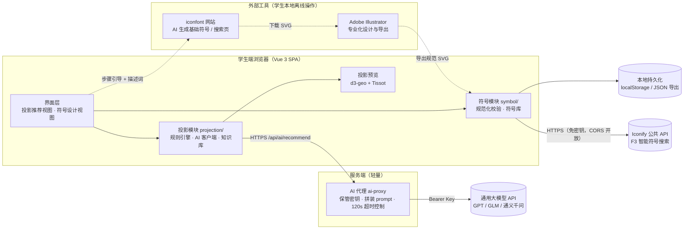
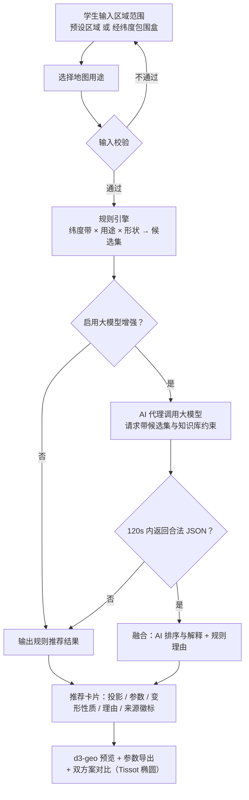
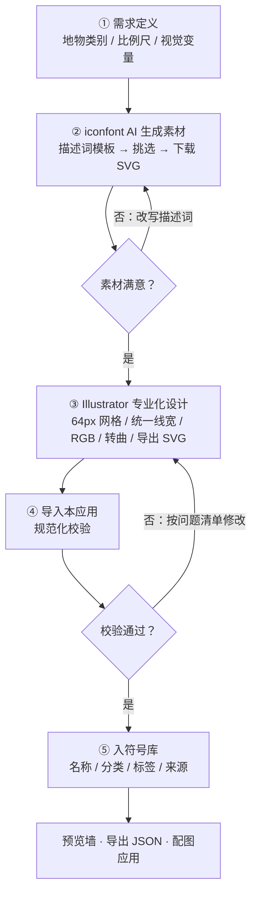

# 04 架构设计

- 版本：v0.1（草案）
- 对应需求：F1 投影推荐、F2 符号设计
- 图源文件：[diagrams/](diagrams/)

## 1. 总体架构



图源：[diagrams/system-architecture.mmd](diagrams/system-architecture.mmd)

要点：

- **SPA 为主，服务端极简**：唯一服务端组件是 AI 代理，职责是保管 API Key、拼装 prompt、
  15s 超时控制与结果校验。符号库本期落在浏览器 localStorage。
- **双模块解耦**：`projection/` 与 `symbol/` 互不依赖，可独立演进与测试。
- **离线兜底**：不启动 AI 代理时，投影推荐走纯前端规则引擎，符号功能完全本地。

## 2. 技术选型

| 层 | 选型 | 理由 |
|----|------|------|
| 前端框架 | Vue 3 + TypeScript + Vite | 课程团队熟悉、生态成熟、启动快 |
| UI 组件 | Element Plus | 中后台组件齐全，中文文档友好 |
| 投影计算/预览 | d3-geo + d3-geo-projection | 支持 20+ 投影与参数化，可直接驱动 SVG 预览 |
| 坐标正算/反算 | proj4js | 直接消费导出的 PROJ4 字符串，与 GIS 软件结果一致 |
| AI 接入 | OpenAI 兼容 Chat Completions | GPT / GLM / 通义千问均提供兼容端点，切换成本为零 |
| AI 代理 | Node 原生 http（无框架依赖） | 单文件、零安装成本，后续可平滑迁移 Express/Nest |
| 持久化 | localStorage →（演进）后端 + 对象存储 | 本期单机可用，接口预留 |

## 3. 目录结构

```
studentmap/
├─ spec/                          # 规格说明（本目录）
│  ├─ README.md
│  ├─ 01-需求规格说明书.md
│  ├─ 02-功能规格-地图投影智能推荐.md
│  ├─ 03-功能规格-地图符号设计.md
│  ├─ 04-架构设计.md
│  └─ diagrams/                   # Mermaid 图源
├─ index.html
├─ package.json / vite.config.ts / tsconfig.json
├─ server/
│  └─ ai-proxy.mjs                # AI 代理（OpenAI 兼容协议；本地开发与 SCF Web 函数共用）
└─ src/
   ├─ main.ts / App.vue
   ├─ router/index.ts
   ├─ views/
   │  ├─ ProjectionRecommendView.vue   # F1 页面（表单+框选地图+双方案对比）
   │  ├─ SymbolDesignView.vue          # F2 页面（五步向导）
   │  └─ SmartSymbolDesignView.vue     # F3 页面（智能符号设计，spec/05）
   ├─ components/
   │  ├─ ProjectionPreview.vue         # d3-geo 预览：经纬网+Tissot+范围框
   │  └─ ExtentMapPicker.vue           # 小地图拖拽框选四至
   ├─ composables/
   │  └─ useIsMobile.ts                # 768px 断点响应式（§9）
   └─ modules/
      ├─ projection/
      │  ├─ types.ts              # RegionExtent / MapPurpose / Recommendation…
      │  ├─ presets.ts            # 预设区域 + 投影知识库（含 pros/cons/epsgHint）
      │  ├─ ruleEngine.ts         # 纬度带×用途×形状 规则推荐
      │  ├─ aiClient.ts           # 大模型调用、解析、降级
      │  ├─ params.ts             # 有效参数（中央经线/标准纬线/分带）
      │  ├─ d3Factory.ts          # KB id → d3-geo 投影实例 + 预览图层
      │  └─ exporters.ts          # PROJ4 / WKT / EPSG 提示导出
      └─ symbol/
         ├─ types.ts              # SymbolRecord…（source 含 iconify）
         ├─ standardize.ts        # SVG 规范化校验（F2/F3 共用）
         ├─ iconify.ts            # Iconify 公共 API：地物词库、搜索、SVG 下载
         └─ library.ts            # 符号库 store（localStorage，F2/F3 共享）
```

## 4. 关键数据流

### 4.1 投影推荐（对应 FR-1.x）



图源：[diagrams/projection-recommend-flow.mmd](diagrams/projection-recommend-flow.mmd)

### 4.2 符号设计（对应 FR-2.x；F3 智能符号设计流程见 spec/05 §3）



图源：[diagrams/symbol-design-flow.mmd](diagrams/symbol-design-flow.mmd)

## 5. AI 代理设计（server/ai-proxy.mjs）

- 端点：`POST` 路径以 `/ai/recommend` 结尾（本地为 `/api/ai/recommend`；宽松后缀匹配以兼容云网关路径前缀），
  请求体 `{ messages: [...] }`（由前端 aiClient 拼装）。
- 行为：注入 `Authorization: Bearer ${LLM_API_KEY}`，转发到 `${LLM_BASE_URL}/chat/completions`
  （`LLM_MODEL` 指定模型，默认 `gpt-4o-mini`；GLM 等只需改环境变量）。
- 防护：`ALLOW_ORIGIN` 限定跨域来源（本地默认 `http://localhost:5173`，线上填 Pages 域名）、
  上游 115s 超时（`UPSTREAM_TIMEOUT` 可调）、上游错误透传状态码与错误内容。
- 配置：`.env`（不入库）：`LLM_API_KEY` / `LLM_BASE_URL` / `LLM_MODEL` / `PORT`（默认 8787）/ `ALLOW_ORIGIN`。
- Vite 开发服务器已配置 `/api → http://localhost:8787` 代理，前端代码无跨域问题。
- **云端形态**：`server/ai-proxy.scf.cjs` 为同职责的 SCF **Web 函数**版本
  （CommonJS，整体替换模板 app.js 内容即可，SCF 固定监听 9000），前端经 `VITE_AI_BASE_URL` 指向函数 URL（见 §7）。

## 6. 安全与合规

1. API Key 只在服务端 `.env`，前端、仓库、日志中均不出现。
2. SVG 入库前强制校验（禁脚本/外部引用），渲染使用 `v-html` 时只允许通过校验的内容。
3. iconfont 素材遵循其站点许可，符号记录保留 `source` 字段以便溯源。

## 7. 部署形态

- **开发**：`npm run dev`（Vite，默认 5173）+ `npm run server`（ai-proxy，8787，可选）。

- **生产（推荐，零成本）**：**GitHub Pages**。`npm run build` 产物为纯静态文件；
  路由使用 hash 模式（`/#/projection`）且资源为相对路径（`base: './'`），
  任意静态托管/子路径都无需服务端回退配置。步骤：

  ```bash
  git init && git add -A && git commit -m "init"        # 首次
  git remote add origin https://github.com/<用户名>/studentmap.git
  git push -u origin main
  npm run deploy                                         # 构建并推送到 gh-pages 分支
  ```

  然后仓库 Settings → Pages → Source 选 `gh-pages` 分支，几分钟后通过
  `https://<用户名>.github.io/studentmap/` 访问。**不需要买域名**。

  **自动部署（v0.3 起，NFR-7）**：`.github/workflows/deploy.yml` 已实现 push 到 main 即自动构建并发布
  （peaceiris/actions-gh-pages 推送到 gh-pages 分支，Pages 设置无需改动；secrets.GITHUB_TOKEN 自动提供）。
  此后日常更新只需 `git push`，`npm run deploy` 留作手动备选。

- **AI 代理上线（可选）**：推荐**腾讯云函数 SCF 的 Web 函数**（免费额度足够课程使用，
  函数 URL 免备案、国内访问稳定）。步骤：

  1. 注册腾讯云并实名认证 → 「云函数 SCF」→ 新建 **Web 函数**（模板创建即可，运行时 **Node.js 18**）；
  2. 创建页下方「函数URL配置」：公网访问启用、授权类型选「开放」（免鉴权）
     （事件函数没有函数URL；API 网关触发器已于 2024-07 停止新建）；
  3. 环境变量：`LLM_API_KEY`（必填）、`LLM_BASE_URL`、`LLM_MODEL`、
     `ALLOW_ORIGIN=https://<你的Pages域名>`、`PORT=9000`；
  4. 「函数代码」页：**模板结构原样保留，不删除、不移动任何文件**；只打开 `app.js`，
     全选清空后粘贴 [server/ai-proxy.scf.cjs](../server/ai-proxy.scf.cjs) 全文，保存并部署
     （CJS 格式，与模板 scf_bootstrap 的 `node app.js` 正好对上）；
  5. 函数配置把「执行超时时间」改为 **30 秒**（默认 3 秒不够大模型返回）；
  6. 「触发管理」复制函数 URL，前端 `.env` 加 `VITE_AI_BASE_URL=<该URL>`，重新 `npm run deploy`。

  不配置则前端静默降级为规则引擎。其他平台（学校服务器 / Vercel Serverless）同理：
  部署 ai-proxy 或等价函数后配置 `VITE_AI_BASE_URL` 即可。

- **域名**：平台免费子域名够用；自有域名可选（国内服务器需 ICP 备案）。
  备选托管：Cloudflare Pages、Netlify、腾讯云 COS 静态网站（均无需改代码）。
  注：F3 智能符号设计依赖 Iconify 公共 API（免密钥、CORS 开放），纯静态托管即可用，无需代理。

## 8. 演进路线

| 阶段 | 内容 |
|------|------|
| v0.1（本期） | 双功能闭环：规则推荐 + 符号工作流与入库；AI 代理可选 |
| v0.2 | d3-geo 投影预览 + Tissot 变形椭圆；符号在简易底图上配图预览 |
| v0.3 | 后端持久化（符号库、推荐历史）、账号与教师端查看 |
| v0.4 | 投影知识库扩充（伪圆柱族、分带计算）、作业提交与点评 |

## 9. 视觉规范（v0.2 起）

- **基调**：浅绿色系。主色 `#3ba272`（青翠绿），深色标题 `#1f7a4d`，页面底色为浅绿纵向渐变（`#eaf5ee → #f2f8f4`）。
- **实现**：不引入主题包，直接在 `src/styles/theme.css` 覆盖 Element Plus CSS 变量（`--el-color-primary` 及其 light/dark 梯度），全局组件自动换色。
- **组件约定**：卡片圆角 12px、1px 浅绿描边、柔和绿色投影；页头白底半透明 + 毛玻璃、吸顶；上传区浅绿底、悬停加深。
- **语义色不动**：成功/警告/错误保持 Element Plus 默认语义色，仅主色换绿，避免误导。
- **响应式（v0.3 起）**：断点 768px。移动端：表单标签顶对齐、双方案对比卡转单列、
  符号页步骤条转纵向、优缺点双列转单列、下拉/数字输入框全宽、页头收窄（≤640px 隐藏文字标题保留标识）；
  实现集中在 `src/styles/theme.css` 的 media query 与各视图 scoped 样式，步骤条方向用 `useIsMobile` 驱动。

## 10. 后端与账号体系（v0.4，spec/06）

- **统一使用腾讯云开发 CloudBase**（2026-10-19 收敛）：认证（邮箱验证码注册 + 邮箱/用户名登录）+
  文档数据库。前端经 `@cloudbase/js-sdk` 直连（SDK 懒加载拆 chunk；权限由集合 PRIVATE 权限兜底，前端不含密钥）。
- 集合 `symbol_libraries`：一用户一文档（`_id = uid`），「读取和修改本人数据 [PRIVATE]」实现学生间隔离。
- `src/modules/cloud/`：`client.ts`（`VITE_TCB_ENV` 判定云端开关 + SDK 懒加载）、`auth.ts`（注册/登录/登录态）、
  `sync.ts`（拉取/推送/合并）。`library.ts` 登录后自动合并 + 防抖同步。
- 部署侧仅需控制台操作（开登录方式、建集合配权限），无自建服务。
- 历史：班级自建服务器方案已于 2026-10-19 下线（git 历史可恢复，见 spec/06 §1）。
